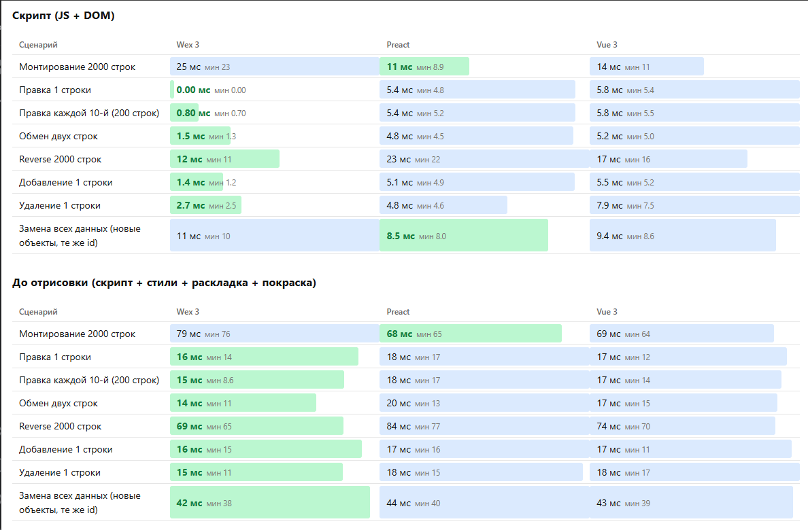
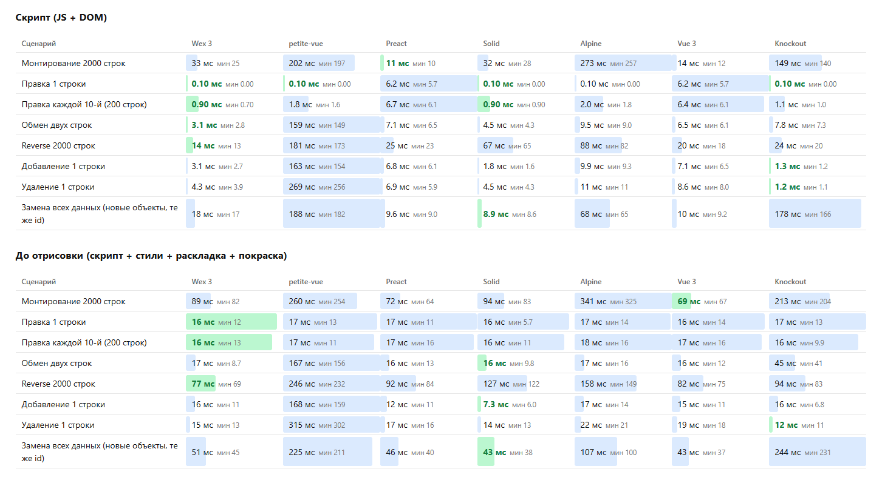

# Wex 3

## Сборка
`npm run build`

## Performance

Сравнивался Wex, Petite Vue (Vue.js CDN) и Preact (React CDN), 18 прогонов:

Полное сравнение всех популярных фреймворков:

Запуск теста вручную: `dist/benchmark/Index.html`

## API
- `Wex.view(html | <template> | '#selector', initState)` вместо `$('<template>').state(...)`; `.mount(el)`, `.method`, `.on`, `.update`, `.hold/.release` как раньше.
- `component(name, view | url, {lazy})`; `directive(name, fn | {mounted, updated, unmounted})`: без jQuery, `fn(el, b)` идёт в эффекте, `b.get()` читает выражение.
- Файл удалённого компонента: `export default ($tpl) => $tpl.state(() => ({...}))` без изменений.

## Что изменилось по поведению
1. Эффект на каждый `{{ }}`, атрибут, `w-if`, `w-for`: правка одной строки пересчитывает только её.
2. `w-for` с traceby: ключевой diff с LIS (минимум перестановок). Ключи теперь локальны списку: перенос карточки между колонками пересоздаёт строку (раньше DOM-узел переезжал).
3. Слот видит scope родителя (раньше ещё и state ребёнка); данные ребёнка в слот отдаются через `<slot :row="row">`.
4. Функции-компоненты (`Link` и т.п.), compile-хуки директив и `$` / `compile($el, attrs)` удалены. Hoist по `view.tag` (компонент вместо тега) не поддержан: компонент всегда рендерится внутрь своего элемента.
5. `view.update(fn)` больше не форсирует рендер; для нереактивных данных (Chart.js) используйте `view.update(true)`.
6. w-атрибуты вырезаются из DOM после разбора; `w-class` теперь снимает класс, когда условие стало ложным.
7. События `w-on`: обработчик получает нативный Event (не jQuery.Event).