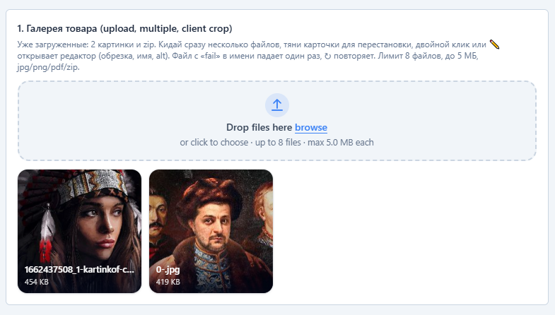
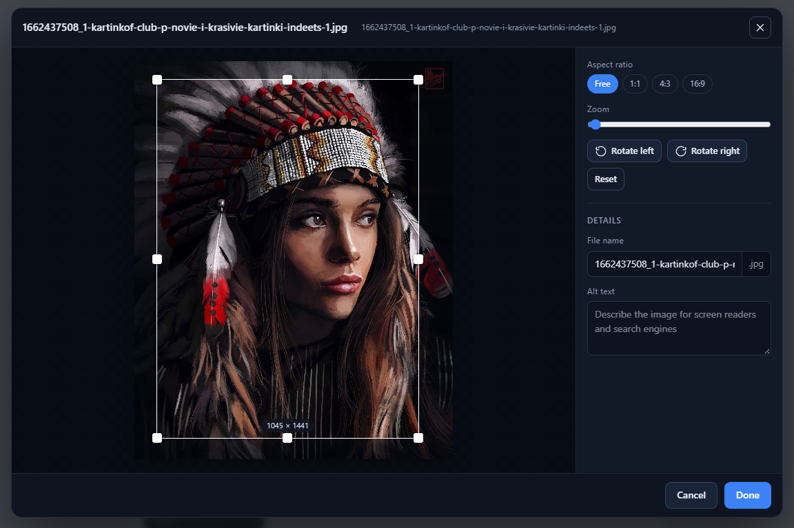
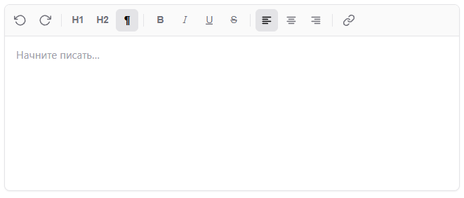
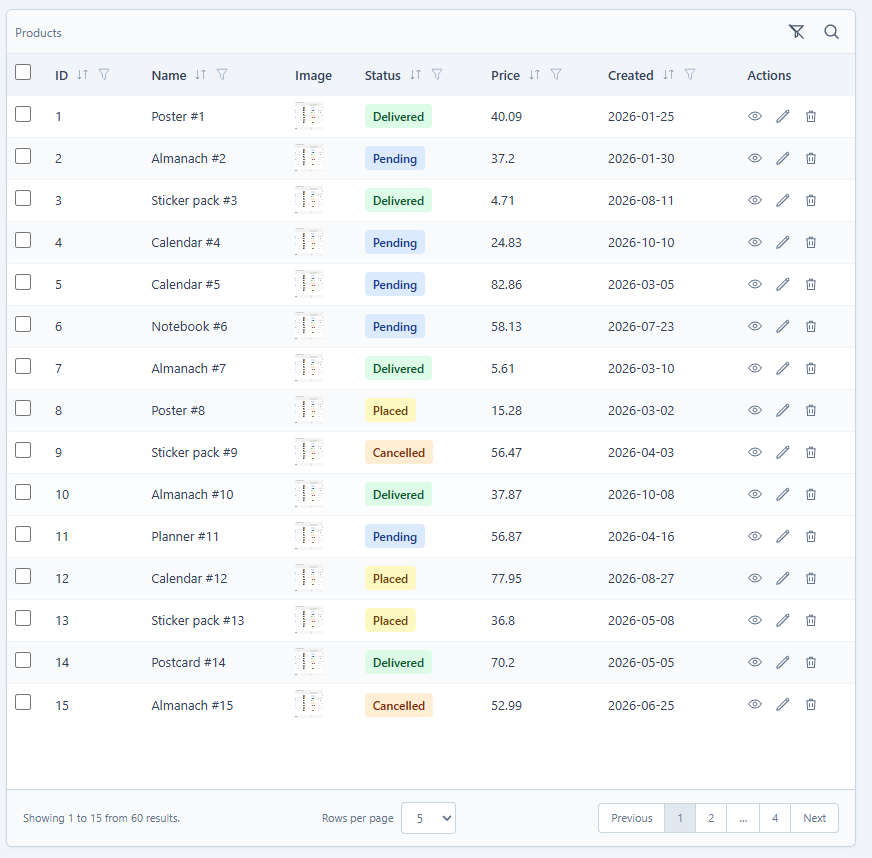
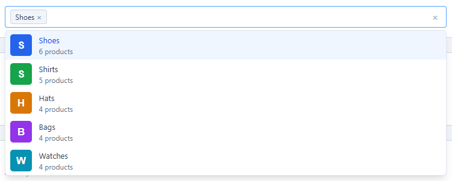
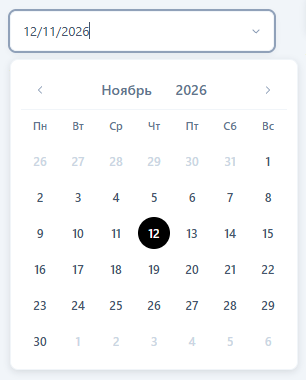
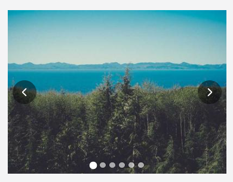
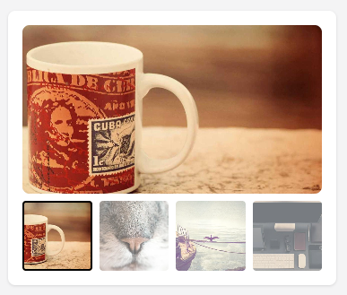

# 🌀 Wex.

Wex - это реактивный CDN фронтенд фреймворк. 

## 🔌⚡ Подключение.

```html
<script src="https://cdn.jsdelivr.net/gh/wemmbley/wex@master/dist/wex.min.js"></script>
```

## Performance

| Сценарий                                     | Wex 3               | petite-vue          | Preact            |
| -------------------------------------------- | ------------------- | ------------------- | ----------------- |
| Монтирование 2000 строк                      | 27 мс (мин. 24)     | 217 мс (мин. 198)   | 13 мс (мин. 11)   |
| Правка 1 строки                              | 0.10 мс (мин. 0.00) | 0.10 мс (мин. 0.00) | 7.1 мс (мин. 6.5) |
| Правка каждой 10-й (200 строк)               | 0.90 мс (мин. 0.80) | 1.7 мс (мин. 1.6)   | 7.0 мс (мин. 6.7) |
| Обмен двух строк                             | 2.6 мс (мин. 2.5)   | 165 мс (мин. 163)   | 5.9 мс (мин. 5.5) |
| Reverse 2000 строк                           | 14 мс (мин. 13)     | 170 мс (мин. 167)   | 24 мс (мин. 23)   |
| Добавление 1 строки                          | 2.4 мс (мин. 2.2)   | 158 мс (мин. 151)   | 5.9 мс (мин. 5.6) |
| Удаление 1 строки                            | 3.9 мс (мин. 3.6)   | 298 мс (мин. 279)   | 6.9 мс (мин. 5.6) |
| Замена всех данных (новые объекты, те же ID) | 17 мс (мин. 17)     | 182 мс (мин. 178)   | 9.1 мс (мин. 8.7) |

## Примеры кода

### ⚡Использование компонентов отдельно из другого HTML-файла! (работает на GitHub Pages!)
`Components/MyComponent.html`:
```html 
<template>
    <slot></slot>
    <p>Встроенный стейт: {{ myState }}</p>
    <p>Статический пропс: {{ varStatic }}</p>
    <p>Динамический пропс: {{ varDynamic }}</p>
</template>

<script type="module">
    export default ($component) => $component
        .state({
            myState: 'Кнопка',
            varStatic: '', 
            varDynamic: '',
        })
</script>
```
`Index.html`:
```html
<template id="app">
    <testComponent varStatic="123" :varDynamic="myVar">
        Содержимое слота
    </testComponent>
</template>

<script>
    $('#app')
       .state({ myVar: 'test' })
       .component('testComponent', 'Components/MyComponent.html')
       .mount()
</script>
```
Внимание! Ваш тэг компонента ВСЕГДА должен иметь закрывающий тэг! `<MyTag></MyTag>`

### 🌏 Загрузка JSON-данных по API-ссылке с плавным появлением при клике на кнопку.

```html 
<template id="wire-test">
    <button class="my-btn">Загрузить посты</button>
    <div w-for="post in posts" w-transition>
        <a href="#">{{ post.title }}</a>
    </div>
</template>
```
```js 
$('#wire-test')
  .state({ posts: {} })
  .on('click', '.my-btn', state => {
    $wire
      .get('https://jsonplaceholder.typicode.com/posts/')
      .to(state.posts)
  })
  .mount()
```

### 🍍 Хранилище стейта в браузере (аналог Pinia/Redux).

Сохраняет все данные положенные в `state.sotorage` между обновлениями страницы.

```html 
<template id="score">
    <p>Score: {{ storage.score }}</p>
    <button class="increase-btn">Increase</button>
</template>
```
```js 
$('#score')
  .state({
    storage: {
      score: 0,
      test: 1,
    }
  })
  .on('click', '.increase-btn', state => {
    state.storage.score = ++state.storage.score;
  })
  .mount()
```

### 🛤️️ Классический SPA-Роутер без перезагрузок.

```html 
<template id="app">
    <nav>
        <a href="#/" w-navigate="push">Главная</a>
        <a href="#/catalog" w-navigate="push">Каталог</a>
        <a href="#/about" w-navigate="push">О нас</a>
    </nav>

    <div w-route="'/'">
        <h1>Добро пожаловать!</h1>
        <p>Это главная страница.</p>
    </div>

    <div w-route="'/catalog'">
        <h1>Каталог товаров</h1>
    </div>

    <div w-route="'/about'">
        <h1>О нас</h1>
    </div>
</template>

<script>
    $('#app').state().mount()
</script>
```

### 🐢 Объявление собственных методов (замена on-событиям)

```html 
<template id="app">
    <p>Count: {{ count }}</p>
    <button w-on="click:increase">Increase</button>
    <button w-on="click:decrease">Decrease</button>
</template>

<script>
    $('#app')
        .state({ count: 0 })
        .method('increase', () => {
            state.count += 1;
        })
        .method('decrease', () => {
            if(state.count >= 1) {
                state.count -= 1; 
            }
        })
        .mount()
</script>
```

### ☄️ Модалки Bootstrap 5 из коробки с глубокой интеграцией в стейт.

Не забудьте подключить сам Bootstrap 5 перед использованием.

```html 
<template id="app">
    <button class="btn btn-primary" w-modal="myModal">Toggle myModal</button>
</template>

<div id="myModal" class="modal fade" tabindex="-1">
    <div class="modal-dialog">
        <div class="modal-content">
            <div class="modal-header">
                <h5 class="modal-title">Моя модалка</h5>
                <button type="button" class="btn-close" data-bs-dismiss="modal"></button>
            </div>
            <div class="modal-body">Просто контент</div>
        </div>
    </div>
</div>
```
```js 
$('#app')
    .state({
        modal: { 
            myModal: false 
        }
    })
    .mount()
```

### 🐳 TODO-Лист (сборка всего функционала Wex в одном месте)

```html 
<template id="app">
    <div>
        <input w-bind="newTodo" placeholder="Новая задача..." />
        <button w-on="click:addTodo">Добавить</button>

        <div w-for="todo,index in todos traceby todo.id">
            <span>{{ todo.text }}</span>
            <button w-on="click:remove(todo.id)">Удалить</button>
        </div>
    </div>
</template>

<script>
    // Выбираем элемент для монтирования
    $('#app')

        // Обьявляем реактивный стейт
        .state(() => ({
            newTodo: '',
            todos: [],
        }))

        // Кнопка добавить
        .method('addTodo', function (state) {
            // Наш инупт забинжен через w-bind="newTodo", данные сразу тут будут
            let inputText = state.newTodo.trim()

            let newTodo = {
                id: Date.now(), // даём уникальный ид
                text: inputText // заносим сюда текст из инпута
            }

            state.todos.push(newTodo) // пушим наш новый туду в стейт
            state.newTodo = '' // очищаем инпут, ведь он забинжен и очистится вместе со стейтом
        })

        // Кнопка удалить
        .method('remove', function (state, id) {

            // формируем список новых тудушек, покаместь пустой
            let newTodos = []

            // пробегаемся по текущим тудушкам чтобы вычислить все айдишники
            for (let i = 0; i < state.todos.length; i++) {

                // создаём новую локальную переменную с текущей тудушкой
                let todo = state.todos[i]

                // проверяем что текущая тудушка из нашей for-крутилки
                // не равна айдишнику удаляемой тудушки
                if (todo.id !== id) {

                    // все остальные тудушки кроме текущей удаляемой добавляем в новый список
                    newTodos.push(todo)
                }
            }

            // реактивно обновляем стейт новыми тудушками без той что мы удалили
            state.todos = newTodos
        })

        // Монтируем
        .mount()
</script>
```

За бОльшим количеством примеров обращайтесь в официальную книгу сообщества в папке `book`.

## 🌲Плагины

Все плагины в Wex являются самостоятельными и независмыми. Они могли вдохновиться 
от знаменитых решений, но, тем не менее, ими не являются. Это всё - самопис, как 
и сам Wex.

Каждый плагин наследуют философию сепарации: он не расширяет функционал Wex 
только после отдельного подключения по CDN после самого `wex`.

### Dropzone

Область для перетаскивания или выбора файлов кликом, с предпросмотром и 
обрезкой изображений, если нужно. 



```html 
<script src="https://cdn.jsdelivr.net/gh/wemmbley/wex@master/dist/wex-dropzone.min.js"></script>
```

### Image Editor

Автоматически доступен после перетаскивания файла картинок в Dropzone. 
Так же доступен к использованию самовольно, в отрыве от Dropzone.



```html 
<script src="https://cdn.jsdelivr.net/gh/wemmbley/wex@master/dist/wex-image-editor.min.js"></script>
```

### Wysiwyg редактор

Имеет встроенное JSON ASM-дерево с рекурсивными дочерними узлами.



```html
<script src="https://cdn.jsdelivr.net/gh/wemmbley/wex@master/dist/wex-editor.js"></script>
```
### Wysiwyg просмотрщик

Нужен для просмотра сгенерированного JSON от Wysiwyg редактора.

```html
<script src="https://cdn.jsdelivr.net/gh/wemmbley/wex@master/dist/wex-doc.js"></script>
```

### DataTable



Требуется Quas, и при желании сохранения URL ссылок пагинации плагин Wex:Router

```html
<script src="https://cdn.jsdelivr.net/gh/wemmbley/quas@master/Source/Quas.js"></script>
<script src="https://cdn.jsdelivr.net/gh/wemmbley/wex@master/dist/wex-datatable.min.js"></script>
```

### Smart Select

Умный select с полностью кастомизированным выпадающим списком, с поиском и 
мультивыбором. Тонкая настройка позволит сделать из него обычный select 
с поиском. Требует `Quas` в зависимостях.



```html
<script src="https://cdn.jsdelivr.net/gh/wemmbley/quas@master/Source/Quas.js"></script>
<script src="https://cdn.jsdelivr.net/gh/wemmbley/wex-js@master/dist/wex-smart-select.js"></script>                                              <!-- после Wex -->
```

### DatePicker

Умный дейтпикер с возможностью так же сделать дейтпикер с выбором времени (чч:мм).
Требует `Quas` в зависимостях.



```html
<script src="https://cdn.jsdelivr.net/gh/wemmbley/quas@master/Source/Quas.js"></script>
<script src="https://cdn.jsdelivr.net/gh/wemmbley/wex-js@master/dist/wex-datepicker.min.js"></script>                                  <!-- после Wex -->
```

### Carousel

Тонко настраиваемый слайдер. Аналог Slick, OwlCarousel, Swiper в 1м флаконе.

Пример обычного слайдера: 



Пример адаптивной карусели с превью изображений на выбор:



Подключение:

```html
<script src="https://cdn.jsdelivr.net/gh/wemmbley/wex-js@master/dist/wex-carousel.min.js"></script>                                  <!-- после Wex -->
```

# 💼 Другие продукты

### Neo
Автономный PHP-движок без внешних зависимостей, лёгкий аналог Laravel.
<br><a href="https://github.com/wemmbley/neo">Ссылка на GitHub репозиторий</a>

### Quas
Независимый Tailwind подобный движок утилитарных классов для CDN.
<br><a href="https://github.com/wemmbley/quas">Ссылка на GitHub репозиторий</a>
<br><a href="https://codeberg.org/wemmbley/quas">Ссылка на CodeBerg репозиторий</a>

## Поддержка.

На 2027 год фреймворк активно поддерживается и разрабатывается. <br>
<br>
О любых багах Вы можете сообщить открыв issue прямо в репозитории по следующей ссылке: https://github.com/wemmbley/wex/issues <br>
<br>
Если Вы заинтересованы в поддержке фреймворка то можете открыть PR: https://github.com/wemmbley/wex/pulls <br>
Поблагодарить автора в денежном или словестном эквиваленте можно тут: https://t.me/saint_lucius <br>
Там же можете и подсказать какую-либо идею под реализацию! ⚡⚡⚡